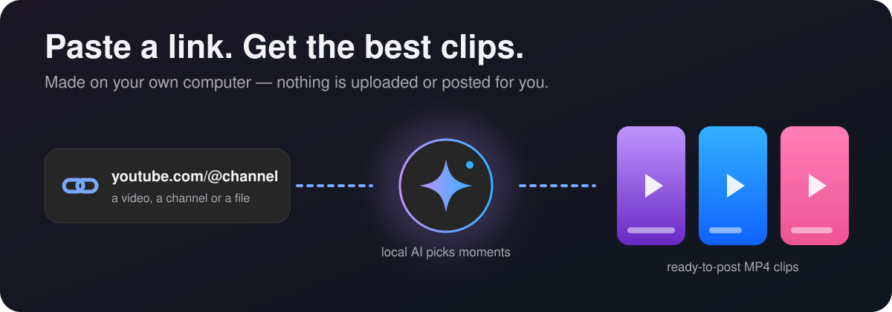
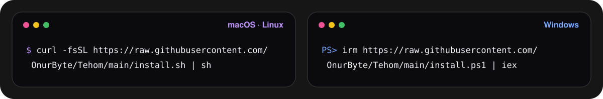
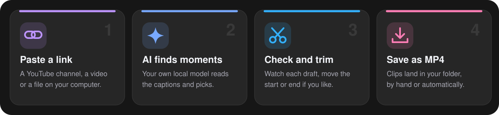
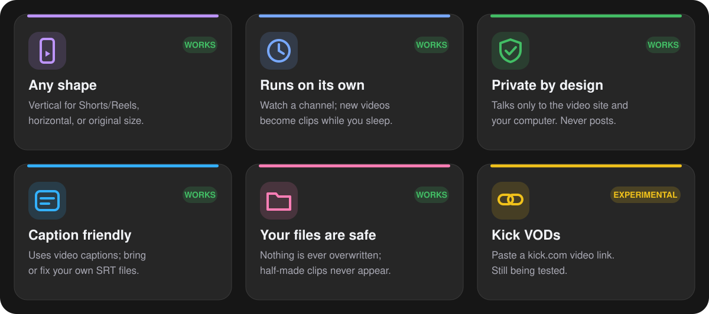
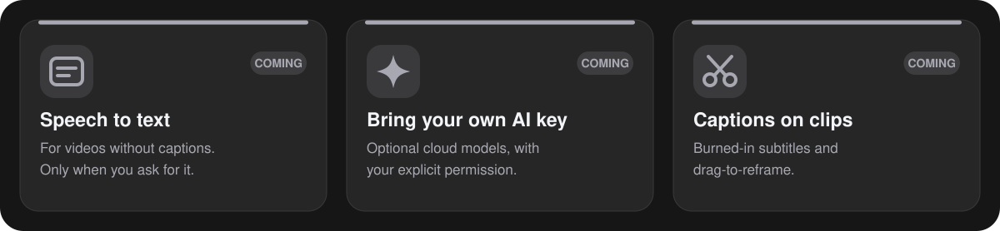

<picture>
  <source media="(prefers-color-scheme: dark)" srcset="assets/brand/icon-dark.svg">
  
</picture>

# Tehom



> **Early version, still in development.** Tested on Linux; macOS and Windows builds run in CI. Cards marked *COMING* are not built yet. Full detail: [status](docs/status.md).

## Install with one command



**macOS and Linux** (Terminal):

```sh
curl -fsSL https://raw.githubusercontent.com/OnurByte/Tehom/main/install.sh | sh
```

**Windows** (PowerShell):

```powershell
irm https://raw.githubusercontent.com/OnurByte/Tehom/main/install.ps1 | iex
```

The installer puts Tehom in your user folder (no admin rights), checks the download's SHA-256 and adds Tehom to your app menu. If FFmpeg, yt-dlp or GStreamer are missing, it shows the exact command and asks before installing them. You also need a local AI model, for example [Ollama](https://ollama.com).

> The installer downloads from [GitHub Releases](https://github.com/OnurByte/Tehom/releases). Until the first release is published, build from source (see [Development](#development)). Release files are checksum-verified but not yet code-signed.

## How it works



## What it can do





---

## For power users

<details>
<summary><b>Command line cheat sheet</b></summary>

| Command | Does |
| --- | --- |
| `tehom ai --model NAME` | Choose your local model |
| `tehom add URL --mode auto-draft` | Add a channel, video or Kick VOD |
| `tehom import-video FILE` | Queue a local file |
| `tehom check` / `tehom run-once` | Look for new videos / process the queue |
| `tehom retry ID` / `tehom cancel ID` | Control one job |
| `tehom status` / `tehom events --video ID` | Read state (works while the daemon runs) |
| `tehom revise-clip ID --start-ms … --end-ms …` | Save a new draft version |
| `tehom export-profile vertical\|horizontal\|original` | Clip shape |
| `tehom save-original ID ~/Videos` | Keep the source video |
| `tehom export-transcript ID edit.srt` | Edit captions, then import them back |
| `tehom import-transcript ID file.tr.srt` | Add a caption version (language from the name) |
| `tehom cleanup --dry-run` | Free space used by downloads |

Modes: `manual`, `auto-draft`, `auto-export`, `paused`. Use `--data DIR` for another data folder.

</details>

<details>
<summary><b>Run in the background (Linux)</b></summary>

```sh
tehom service install --config ~/.config/tehom/tehom.toml --enable
tehom service uninstall --disable
```

Copy [`config/tehom.example.toml`](config/tehom.example.toml) first. Every key is either applied or rejected with a reason. See the [user-service guide](docs/headless-service.md).

</details>

<details>
<summary><b>Safety and limits</b></summary>

- The engine only contacts `www.youtube.com` and your loopback model; social and publishing APIs are refused in code. yt-dlp downloads the videos.
- Writes are atomic and never replace existing files; partial renders are never published. [Disk and model details](docs/disk-and-models.md).
- No web app, SaaS, accounts, social upload, scheduler or AppImage.

</details>

<details id="development">
<summary><b>Development</b></summary>

Needs Rust 1.99.1, FFmpeg/ffprobe, yt-dlp and GStreamer with base, good and libav plug-ins. The [CI workflow](.github/workflows/native-prototype.yml) lists exact packages per platform.

```sh
cargo run -p tehom-desktop
cargo fmt --all --check
cargo clippy --workspace --all-targets --locked -- -D warnings
cargo test --workspace --locked
packaging/release-archive.sh       # the archive the installers download
packaging/linux/build-deb.sh       # optional unsigned .deb
```

Pushing a `v*` tag runs the [release workflow](.github/workflows/release.yml), which builds the archives for Linux (x86_64, arm64), macOS (Apple Silicon, Intel) and Windows. Card images are generated by [`assets/readme/generate.py`](assets/readme/generate.py).

</details>

**Licence:** AGPL-3.0-or-later. Geist fonts under the included OFL. The brand logo is the original supplied design; see [asset provenance](assets/README.md).
