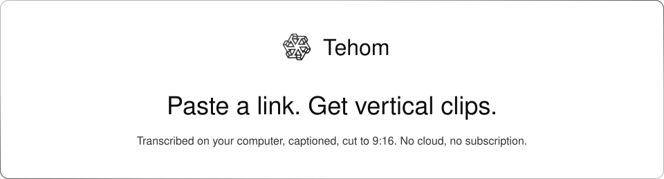
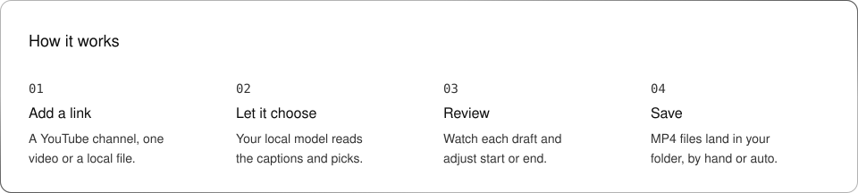
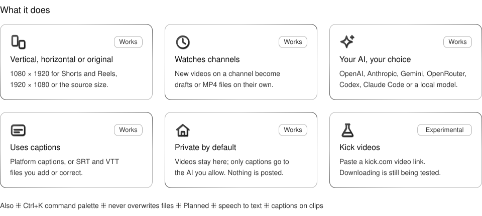
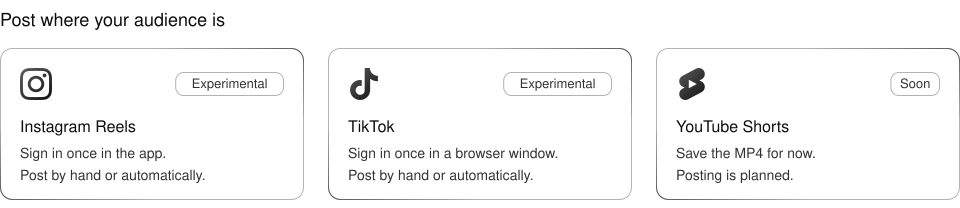

<picture>
  <source media="(prefers-color-scheme: dark)" srcset="assets/readme/hero-dark.svg">
  
</picture>

<p align="center">
  <a href="https://github.com/OnurByte/Tehom/releases/latest"><b>Download</b></a> ⁜ Linux, macOS and Windows ⁜ Free and open source ⁜ Built with <a href="https://gpui-kit.com/">GPUI Kit</a>
</p>

## Install

###   macOS and Linux

Open **Terminal** and paste:

```sh
curl -fsSL https://raw.githubusercontent.com/OnurByte/Tehom/main/install.sh | sh
```

###  Windows

Open **PowerShell** and paste:

```powershell
irm https://raw.githubusercontent.com/OnurByte/Tehom/main/install.ps1 | iex
```

Then open **Tehom** from your apps. A short guide helps you choose an AI the first time.

**Updating:** when a new version is out, a card appears at the bottom of the sidebar. Choose **Update** there, or run `tehom update`.

## How it works

<picture>
  <source media="(prefers-color-scheme: dark)" srcset="assets/readme/steps-dark.svg">
  
</picture>

<picture>
  <source media="(prefers-color-scheme: dark)" srcset="assets/readme/features-dark.svg">
  
</picture>

<picture>
  <source media="(prefers-color-scheme: dark)" srcset="assets/readme/post-dark.svg">
  
</picture>

## Choose your AI

| Option | You need |
| --- | --- |
| API key | An OpenAI, Anthropic, Gemini or OpenRouter key |
| Subscription | Codex or Claude Code, signed in |
| This computer | Ollama, LM Studio, llama.cpp or vLLM |

Tehom lists the models your choice offers, with a plain note on how capable each one is. Only captions go to the AI you choose. Your videos and clips stay on your computer.

## Good to know

- **No captions?** Tehom writes them on this computer. The speech tool comes with the app; one click in Settings downloads the speech model (about 150 MB).
- **Edit in Studio.** Change caption text, colour, size, position and the intro sound, then make the video again.
- **Sources.**  YouTube channels and videos,  Kick channels and stream recordings (experimental), any RSS or Atom feed with video, or a file from your computer.
- **Studio.** Its own tab: player, timeline, trim points and a caption editor. A hook check reads the first 3 seconds for you; phone view shows the 9:16 crop with the bands the apps cover; loop and sound-off playback show the clip the way a feed does. Quick looks, colours, size and a slider to place captions at any height.
- **Automations.** Every channel you follow is one. Choose what happens to new videos and which account its clips are posted to; each source can use a different one. The same page sets how often to check, clips per video and clip length.
- **Connections.** Connect Instagram, TikTok, YouTube Shorts, Bluesky or Facebook Reels, then post a clip by hand or let auto-export post for you. Instagram, TikTok and YouTube Shorts use unofficial routes, so the platform may ask you to confirm a login or restrict the account; use one you can afford to lose access to. Bluesky (handle and app password) and Facebook Reels (Page id and Page access token from your own Meta app) use the platforms' official APIs. All five are experimental and untested against the live services. LinkedIn, Snapchat Spotlight, Bilibili, Kwai and Likee are planned.
- **Your colours.** Light or dark, plus six accent colours. Press **Ctrl+K** (**Cmd+K** on Mac) or click the search box to find any action.

---

<details>
<summary><b>Command line</b></summary>

```sh
tehom ai --provider codex --consent          # or openai, anthropic, gemini, openrouter, claude-code, local
tehom ai-key anthropic                       # saves a key in your system keyring
tehom add https://www.youtube.com/@channel --mode auto-export
tehom run-once                               # check and process now
tehom status                                 # what is happening
tehom export-profile vertical                # or horizontal, original
tehom update                                 # install the latest version (--rollback undoes it)
tehom info                                   # version, folders and AI in use
tehom service install --config tehom.toml --enable   # keep running in the background (Linux)
```

Run `tehom --help` for every command. Settings file: [`config/tehom.example.toml`](config/tehom.example.toml).

</details>

<details>
<summary><b>Privacy and safety</b></summary>

- Tehom posts nothing unless you connect an Instagram, TikTok or YouTube account and choose to publish or turn on automatic posting. Otherwise it only talks to the video site, RSS feeds you add, and the AI you allow.
- Instagram publishing uses Instagram's private mobile protocol, not an official API. Instagram may change it or restrict accounts that use it; use an account you can afford to lose access to.
- TikTok and YouTube Shorts publishing are unofficial too. You sign in yourself in a Chrome, Chromium, Edge or Brave window with Tehom's own profile; Tehom never sees your password, and the window opens again while a clip uploads. The platform may change this or restrict the account.
- Speech is transcribed on this computer with whisper.cpp when a video has no captions.
- API keys live in your system keyring, never in Tehom's files.
- Existing files are never overwritten, and half-made clips never appear.

More: [security](docs/security.md), [disk and models](docs/disk-and-models.md).

</details>

<details>
<summary><b>Build from source</b></summary>

A native Rust app built with [GPUI Kit](https://gpui-kit.com/). Needs Rust 1.99.1, FFmpeg, yt-dlp and GStreamer (base, good and libav plug-ins).

```sh
cargo run -p tehom-desktop
cargo test --workspace
```

Status and evidence: [docs/status.md](docs/status.md).

</details>

AGPL-3.0-or-later ⁜ Geist fonts under the OFL ⁜ [Asset provenance](assets/README.md)
